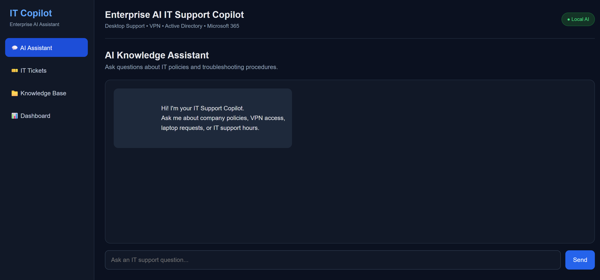
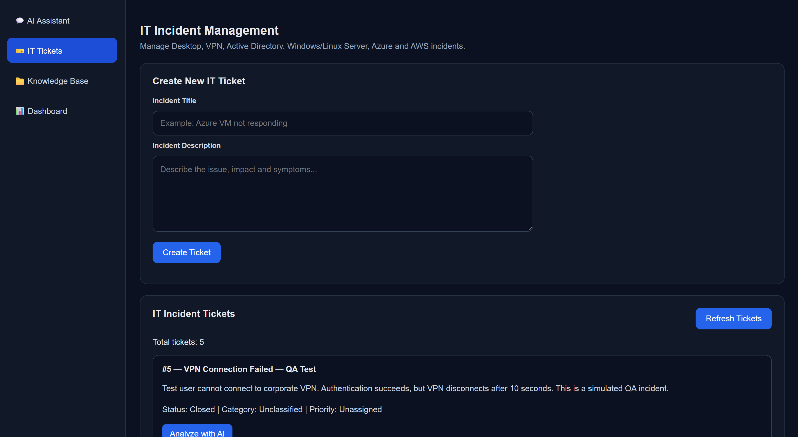
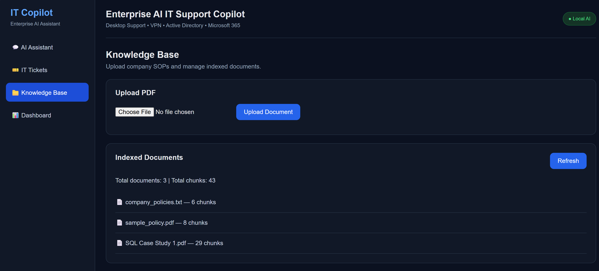
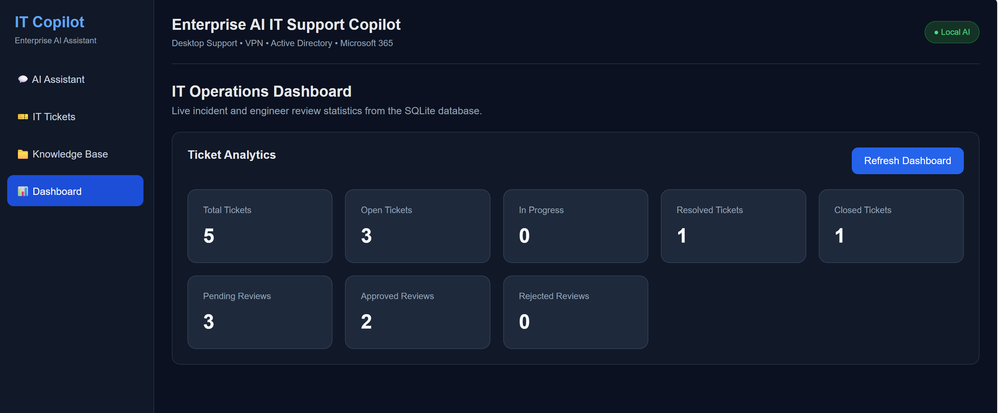

# Enterprise AI IT Operations Copilot

A local AI-powered IT incident management and knowledge assistant built using FastAPI, Ollama, ChromaDB, SQLite, and a JavaScript frontend.

## Overview

Enterprise AI IT Operations Copilot is a portfolio project designed to demonstrate how Generative AI can assist IT support engineers with troubleshooting, knowledge retrieval, incident analysis, and human-reviewed ticket management.

The application runs locally and uses Ollama for AI inference.

## Key Features

- **AI Knowledge Assistant:** Answer IT support questions using a local language model and retrieval-augmented generation (RAG).
- **PDF Knowledge Base:** Upload PDF documents, extract content, generate embeddings, and store searchable chunks in ChromaDB.
- **IT Incident Management:** Create, view, and manage IT support tickets.
- **AI Incident Analysis:** Generate suggested categories, priorities, troubleshooting steps, and escalation recommendations.
- **Basic Safety Guardrails:** Identify potentially risky AI-generated troubleshooting actions for human review.
- **Engineer Review Workflow:** Record approval or rejection decisions with reviewer names and notes.
- **Ticket Lifecycle:** Move tickets between Open, In Progress, Resolved, and Closed.
- **Dashboard Analytics:** View ticket and review statistics retrieved from SQLite.

## Technology Stack

| Layer | Technology |
|---|---|
| Backend API | Python, FastAPI |
| Local LLM | Ollama, Qwen 2.5 1.5B |
| Embeddings | Ollama, nomic-embed-text |
| Vector Database | ChromaDB |
| Relational Database | SQLite |
| PDF Processing | PyMuPDF |
| Frontend | HTML, CSS, JavaScript |
| API Testing | Swagger UI |
| Development Environment | VS Code, Windows |

## Architecture

```text
User
  |
  v
HTML / CSS / JavaScript Frontend
  |
  v
FastAPI Backend
  |
  +----> Ollama LLM
  |         |
  |         +----> AI Chat and Incident Analysis
  |
  +----> RAG Service
  |         |
  |         +----> Ollama Embeddings
  |         |
  |         +----> ChromaDB Knowledge Base
  |
  +----> SQLite Database
            |
            +----> Tickets
            +----> AI Analysis
            +----> Engineer Reviews
            +----> Ticket Status
```

## Local Installation

### Prerequisites

- Python 3.13
- Ollama installed and running
- Git
- A modern web browser

### 1. Clone the repository

```powershell
git clone https://github.com/YOUR_USERNAME/enterprise-genai-platform.git
cd enterprise-genai-platform
```

Replace `YOUR_USERNAME` with your GitHub username after creating the repository.

### 2. Create a virtual environment

```powershell
python -m venv .venv
```

Activate it:

```powershell
.\.venv\Scripts\Activate.ps1
```

### 3. Install Python dependencies

```powershell
python -m pip install -r requirements.txt
```

### 4. Download Ollama models

```powershell
ollama pull qwen2.5:1.5b
ollama pull nomic-embed-text
```

Ensure Ollama is running before starting the backend.

### 5. Start the backend

```powershell
python -m uvicorn backend.app.main:app --reload
```

Backend URL:

`http://127.0.0.1:8000`

Swagger API documentation:

`http://127.0.0.1:8000/docs`

### 6. Open the frontend

Open `frontend/index.html` in your browser.

## Example Workflow

1. Create an IT incident ticket describing a VPN or Windows Server issue.
2. Run AI analysis to generate troubleshooting recommendations.
3. Review AI-suggested category, priority, and potentially risky actions.
4. Submit an engineer approval or rejection with notes.
5. Update the ticket status as the simulated incident progresses.
6. View updated metrics in the dashboard.

## Testing

The following workflows have been manually tested in the local development environment:

- FastAPI health endpoint
- AI assistant responses
- Knowledge Base document listing and PDF upload
- Ticket creation and retrieval
- AI incident analysis
- Engineer approval
- Ticket status updates
- Dashboard statistics

Automated test coverage and deployment testing are planned improvements.

## Security and Limitations

This is a local portfolio demonstration, not a production-ready enterprise incident management system.

- Engineer identity is entered manually; authentication and role-based access control are not implemented.
- Review records currently store the latest decision rather than a complete audit history.
- Safety detection uses basic rules and does not guarantee identification of every dangerous action.
- AI-generated troubleshooting instructions must be verified by qualified engineers.
- Ticket approval and status changes do not execute infrastructure commands or verify that an incident was actually resolved.
- Local databases, vector stores, credentials, and private documents should not be committed to the repository.

## Future Improvements

- User authentication and role-based access control
- Full audit logging for ticket reviews and status changes
- Automated backend and frontend tests
- Improved retrieval evaluation and source citations
- Docker-based local deployment
- Enhanced AI safety validation

## Project Purpose

This project demonstrates practical experience with local LLM integration, retrieval-augmented generation, REST API development, vector databases, structured AI output, SQLite persistence, and human-in-the-loop workflows.


## Application Screenshots

### AI Assistant
Local AI-powered IT troubleshooting assistant.



### Ticket Management
AI-powered incident analysis, engineer review, and ticket lifecycle management.



### Knowledge Base
PDF document management and retrieval-augmented generation.



### Dashboard
IT incident statistics and review tracking.




## Manual API Testing Results

Core application workflows were manually tested using FastAPI Swagger UI (`http://127.0.0.1:8000/docs`).

| Feature | Test Result |
|---|---|
| AI Chat using Ollama | Passed |
| RAG-based Knowledge Base Chat | Passed |
| Document Upload and Retrieval | Passed |
| IT Ticket Creation | Passed |
| AI Incident Analysis | Passed |
| Engineer Review and Approval | Passed |
| Ticket Status Lifecycle | Passed |
| Dashboard Statistics | Passed |

### Ticket Lifecycle Validation

Test Ticket #6 (`VPN Disconnecting Frequently`) was used to validate the incident management workflow:

1. Created a new IT support ticket.
2. Generated AI-based incident analysis and troubleshooting recommendations.
3. Saved engineer approval with review notes.
4. Updated the ticket through Open → In Progress → Resolved → Closed.
5. Verified the final ticket counts using the dashboard statistics API.

### Final Dashboard Verification

| Metric | Verified Value |
|---|---:|
| Total Tickets | 6 |
| Open Tickets | 3 |
| In Progress Tickets | 0 |
| Resolved Tickets | 1 |
| Closed Tickets | 2 |
| Pending Reviews | 3 |
| Approved Reviews | 3 |
| Rejected Reviews | 0 |

### Current Limitations

- The application runs locally and has not been deployed to a production environment.
- Testing was performed manually; automated regression tests are not yet implemented.
- Authentication and role-based access control are not yet implemented.
- AI-generated recommendations require human verification before real-world execution.
- AI-suggested incident priority is not automatically applied to the ticket record.